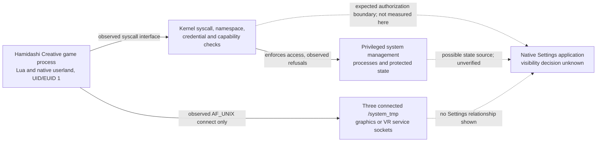

# System boundary map for the native Debug Settings entry

Offline assessment, 2026-10-24. The target is an entry rendered by the **actual PS5 Settings application**. The repository contains no authenticated 14.10 Settings application code, no observed visibility predicate, and no game-to-Settings call with a demonstrated menu effect. The [reported public 14.10 video](../../../2026-10-19-loader-reset.md#public-1410-demonstration-checked-2026-10-20) concerns someone else's console and is explicitly secondary evidence.

The dashed arrows are **questions or expected OS boundaries**, not discovered data flows. The Settings application's process identity was not measured. No direct game-to-Settings call is supported by the captures.

The locally documented IPC building blocks are ordinary AF_UNIX sockets, selected syscall wrappers, and the reverse-engineered Sony 532/622 dispatchers. The repository's 13.60 syscall name map and third-party PS4 header are useful leads, but neither is a documented, version-matched PS5 14.10 Settings API. No official Settings service contract or entitlement specification was present in the offline artifacts audited here.

## Observed boundaries

1. **Game process.** The loader-reported identity is PID 147 and UID/EUID/GID/EGID 1 on a 14.10 session ([raw identity](../../../../results/phase1_identity_layout/01_identity_20261015_184244.txt#L4-L17)); syscall 585 returned `1` under the corrected `is_in_sandbox` label ([raw result](../../../../results/phase15_native_sysent/syscall_isolation_sweep_20261020_193825.txt#L16)). A child native thread wrote a marker in ring-3 memory ([raw marker](../../../../results/phase17_new_vectors/156d_thr_create_child_executes_20261020_164412.txt#L15-L23)). These observations establish current-process execution, not another process's memory or credentials.
2. **Kernel boundary.** The game can invoke syscalls through its Lua/native wrappers, but the kernel still handles authorization. The root survey refused `/system`, `/data`, `/user`, and `/mnt` while allowing `/app0` and `/dev` ([raw roots](../../../../results/phase17_new_vectors/290a_fs_roots_20261022_110740.txt#L3-L14)). Debug/security device opens, including `dbggc` and `sbl_srv`, were refused in tested modes ([raw device sweep](../../../../results/phase17_new_vectors/298a_dbggc_sweep_20261022_112208.txt)). These are measured access failures, not proof the paths are absent system-wide. Kernel read/write remains unverified ([raw loader initialization](../../../../results/phase17_new_vectors/125a_ipv6_krw_init_20261020_034735.txt#L7-L27); [evidence audit](../../../PROGRESS_AUDIT.md#demonstrated-1410-kernel-readwrite-025)).
3. **Reachable services.** `/system_tmp` contains seven UNIX socket names; only the restricted compositor, VR tracker, and AGC compositor sockets accepted a stream connection in the 296a run ([raw socket result](../../../../results/phase17_new_vectors/296a_system_sockets_20261022_111702.txt#L3-L16)). The later compositor replies carry errors or no session, and a larger write caused a temporary black display ([service record](../../../SYSTEM_SOCKETS_14_10.md#what-the-daemons-do-with-input)). This is transport reachability to other processes, not an authorized Settings operation.
4. **Privileged system management.** Calls and opens that would cross beyond process-owned state have failed in tested shapes. The 532 dispatch returned `-1` for several gated commands and status errors/constants for its reachable subset ([raw map](../../../../results/phase17_new_vectors/307a_sys532_argument_map_20261022_120556.txt#L3-L28); [handle survey](../../../../results/phase17_new_vectors/433a_sys532_handle_map_20261022_235907.txt)). The `/dev/dipsw` read-only open worked, but `O_RDWR` failed ([raw DIP switch result](../../../../results/phase21_kernel_leak/132a_srop_dipsw_dmem_20261021_223550.txt#L5-L9)). These results do not disclose the management process's identity or the real menu state owner.
5. **Settings application.** The game module list includes `libSceRegMgr.sprx`, `libSceAvSetting.sprx`, and `libSceSystemService.sprx` ([raw module list](../../../../results/phase9_kaslr_defeat/42i_vmquery_20261016_070711.txt#L14-L47)), but no Settings application image or menu predicate is present in this evidence. A library mapped in the game can be a client stub; its presence gives neither a Settings export nor authorization for a configuration mutation.

## IPC and configuration candidates

| Candidate | Interface exists? | Reachable from game? | Authorization shown | Plausible route to actual menu? | Unknown that matters |
| --- | --- | --- | --- | --- | --- |
| Generic `sysctl` configuration | The `202` syscall and selected reads are captured. | Yes for the tested read OIDs; one securelevel-labeled write returned `-1`. | No accepted system-state write shown. Names/MIBs in the old probe are partly assumptions ([raw 43f](../../../../results/43f_sysctl_write_20261016_180756.txt#L5-L21); [correction](../../../FINDINGS.md#finding-42-recorded-sysctl-operations-probe-43f)). | Unknown; no verified Debug Settings OID or Settings consumer. | Exact 14.10 OID, permissions, persistence, and whether Settings reads it. |
| `libSceRegMgr` / `libSceSystemService` | Module names are in the game's loaded list; no version-matched Settings API contract was identified. | Modules present; no verified Settings-related exported function or call. | None for global configuration. | Potential *research lead* because these are service-client names, but no causal evidence. | Exact version-matched exported query/setter, ABI, entitlement, and visibility predicate. |
| Syscall 532, once labeled `regmgr_call` | A proprietary dispatcher is present in 13.60 static work and responds on 14.10. | Limited command range only; accepted dispatches returned handle/status failures or constants ([raw 307a](../../../../results/phase17_new_vectors/307a_sys532_argument_map_20261022_120556.txt#L3-L28); [raw 309a](../../../../results/phase17_new_vectors/309a_sys532_handless_commands_20261022_120715.txt#L2-L29)). | Gated commands refused; no usable registered handle found. | No Settings relationship demonstrated; a historical name is not an API contract. | What the handler actually owns on 14.10, and whether a documented client path exists. |
| Syscall 622 IPC/device dispatcher | A callable dispatcher is captured. | Yes for tested shapes, but statuses such as `0xFFFFFFFF`/`0x8002004E` indicate no useful operation ([raw 305a](../../../../results/phase17_new_vectors/305a_sys622_unauth_20261022_120414.txt#L1-L8)). | No demonstrated Settings service session or device context. | No evidence of Settings routing. | Target endpoint, ABI, client entitlement; unsafe command shapes already have incomplete captures. |
| `/dev/dipsw` state | Node and a read-like ioctl are observed. | Read-only open; `O_RDWR` refused; tested values were zero ([raw 132a](../../../../results/phase21_kernel_leak/132a_srop_dipsw_dmem_20261021_223550.txt#L5-L9); [raw 132c](../../../../results/phase21_kernel_leak/132c_srop_dipsw_write_20261021_223951.txt#L5-L29)). | No accepted write or documented meaning for queried indices. | A feature-state observation is conceivable; influence on the menu is unproven. | Exact switch semantics and whether Settings consults it. |
| Syscall 606 `is_development_mode` label | A 13.60 name map gives this label; the 14.10 call returned `0` ([raw result](../../../../results/51b_accessible_syscall_deep_20261016_214832.txt#L26)). | The no-argument call returned. | It is only a passive result in this record. | It might classify one system state but cannot itself make the entry visible. | 14.10 return semantics and any relation to Settings. |
| App-scoped state and named objects | The loader logs under `/av_contents`; named-object lookup is a kernel object mechanism. | App data is reachable; names registered in another game process were not found after relaunch ([raw object result](../../../../results/phase17_new_vectors/342a_named_objects_after_relaunch_20261022_125458.txt)). | No persistent system configuration access shown. | No evidence that the Settings process observes this game data or object namespace. | A documented cross-process contract, if one exists. |
| Connected `/system_tmp` sockets | Three connects succeeded. | Yes at transport level. | No Settings protocol, and compositor commands that carry data returned errors ([record](../../../SYSTEM_SOCKETS_14_10.md#the-compositor-protocol)). | Low on present evidence; endpoints are graphics/VR. | A separately documented, game-authorized Settings service would be needed. |

## Supported calls versus privilege escalation

A **legitimate supported route** would need a version-matched API contract, a call the game is entitled to make, and an observed change in the native Settings application's menu entry. The repository demonstrates none of those three together. Calling a guessed selector, forging a handle, using an undocumented offset, or finding a parser failure would be vulnerability research; it would not be evidence that the game has an authorized configuration interface. A syscall wrapper returning `0` while an output status is an error also fails this test.

## Feasibility judgment

**C — the actual visibility mechanism remains unknown.** The current game foothold reaches selected kernel and service interfaces, but none is shown to influence the genuine entry. **B applies to the specific protected-write routes tested:** they refused the game's tested calls or require an as-yet-unidentified authorized service/session. The evidence does not support **A**, a documented unprivileged route. It would also overstate the evidence to claim that kernel R/W is necessarily required for the menu; the Settings-side predicate has not been recovered.
